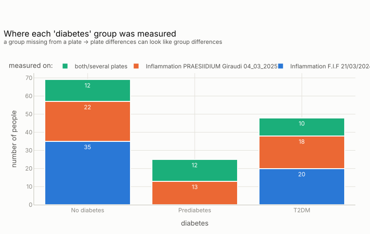
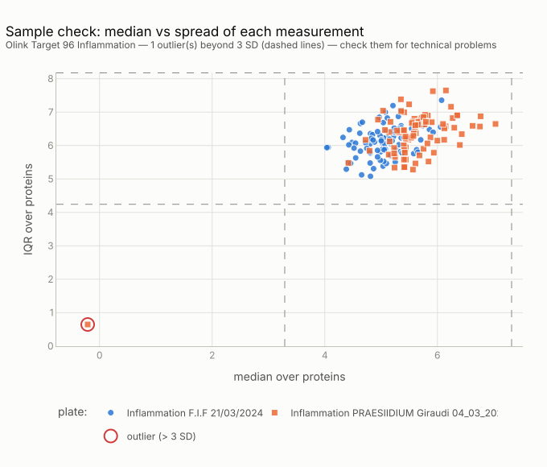
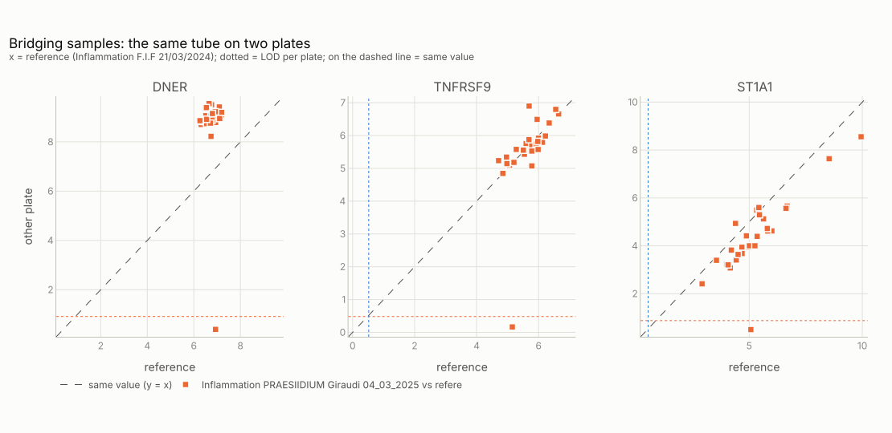
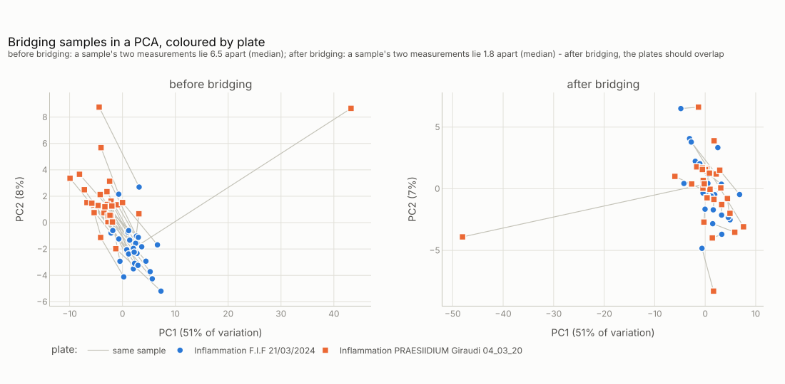

# Get started

From two raw Olink plate files to quality-checked, bridged data, on a free public dataset.
Every output on this page is real; a few long lines are shortened.
{ .lede }

## 1. Install

Python 3.10 or newer. Not on the package index yet, so install from GitHub:

```bash
pip install "signatomics[olink] @ git+https://github.com/ElenaStamatelou/signatomics"
```

`[olink]` adds what the Olink module needs: `pyarrow` (parquet), `openpyxl` (Excel) and `plotly`
(charts). A separate environment (`python -m venv .venv`) keeps it away from your other projects.

## 2. Get example data

**PAD000040** from the PRIDE archive (free to use, CC0): Olink Target 96 Inflammation, 92 proteins,
142 people with severe obesity, two plates, diabetes status. Download three files from
[PRIDE: PAD000040](https://www.ebi.ac.uk/pride/archive/projects/PAD000040) into one folder:

| File | What it is |
|---|---|
| `inflam_NASH_dt1.raw.csv` | plate 1, raw |
| `inflam_PRA_dt2.raw.csv` | plate 2, raw |
| `2025.05.08_sample_manifest.xlsx` | the sample list, with diabetes status |

<p class="small">Milito MM, …, Giraudi PJ. Inflammatory proteomic heterogeneity beyond glycemia
status in severe obesity. Int J Mol Sci 2026;27(9):4152.
<a href="https://doi.org/10.3390/ijms27094152">doi:10.3390/ijms27094152</a></p>

## 3. Read the two plates

```python
import pandas as pd
import signatomics.olink as so

plates = pd.concat([so.read_npx("inflam_NASH_dt1.raw.csv"),
                    so.read_npx("inflam_PRA_dt2.raw.csv")], ignore_index=True)
```

```text
Reading report
  file: inflam_PRA_dt2.raw.csv
  file type: text, separated by comma
  layout: long (one row per sample and protein)
  standard column names: PlateLOD -> LOD
  NPX: converted 184 values written as No Data -> empty
  MissingFreq: converted percentages
  result: 8096 rows, 88 sample IDs, 92 proteins, 88 sample measurements, 1 plates
```

The result is the [standard table](reference/index.md#the-standard-table): one row per sample
and protein.

## 4. Attach the sample list

```python
data = so.add_sample_info(plates, "2025.05.08_sample_manifest.xlsx", on="FIF ID")
```

```text
Matching report
  protein data: 143 sample IDs; sample list: 142 IDs (matched on 'SampleID' = 'FIF ID')
  matched: 142
  WARNING in protein data but NOT in the sample list (kept, without sample information): 249
  columns that exist in both files got the ending _samplelist: PlateID
```

`on` names the ID column in the sample list. Sample 249 has no row there: it is kept and
reported, not silently dropped.

## 5. Look at quality, then act

```python
so.qc_report(data, group="diabetes", show_ids=False)
```

```text
Quality report
  178 sample measurements of 143 sample IDs, 92 proteins, 2 plates
  quality warnings: 17 measurements
  WARNING completely empty measurements (no values at all): 2 (IDs hidden)
  on more than one plate (bridging samples): 35
  proteins below the detection limit in more than 50% of measurements: 14 of 92
  sample measurements that look odd (median or spread over all proteins more than 3 SD from
    the others; see plot_sample_qc): 1 (IDs hidden)
  WARNING group mixed up with plate: no 'Prediabetes' measured only on Inflammation F.I.F 21/03/2024.
    Plate differences can look like group differences — bridge/normalise the plates and check
    before comparing groups.
```

Two findings matter here. People with prediabetes were measured only on plate 2 (or on both), so
a plate difference would look like a diabetes difference: bridge before comparing.

<figure class="sg-chart" markdown>
{ loading=lazy }
<figcaption markdown>`so.plot_group_by_plate(data, "diabetes")`. Nobody with prediabetes was measured on plate 1 alone.</figcaption>
</figure>

And one measurement looks odd: sample 249 on plate 2, about 5 NPX too low on almost every protein.

<figure class="sg-chart" markdown>
{ loading=lazy }
<figcaption markdown>`so.plot_sample_qc(data)`. Each dot is one measurement; the red ring, far to the left, is sample 249 on plate 2.</figcaption>
</figure>

```python
clean = so.apply_qc(data, show_ids=False)
```

```text
Quality steps applied
  removed 2 measurements (no values): 2 (IDs hidden)
  removed 15 measurements (quality warning): 14 (IDs hidden)
  kept: 161 measurements, 132 sample IDs, 92 proteins
```

All proteins are kept unless you give a threshold (`max_below_lod=`): a protein undetectable in
one group but measurable in another can itself be a biomarker. To remove the odd measurement as
well, see the recipe [remove an outlier on one plate](how-to/index.md#remove-an-outlier-on-one-plate).

## 6. Line up the plates

```python
so.bridge_check(clean, group="diabetes", show_ids=False)
```

```text
Bridging check
  reference: Inflammation F.I.F 21/03/2024
  Inflammation PRAESIIDIUM Giraudi 04_03_2025: 29 bridging samples; reads +0.52 NPX vs the
    reference (median over proteins; per protein -0.96 to +2.30; 1.44 times)
    proteins shifted by more than 0.1 NPX: 83 of 92 - bridging needed
    noise: the bridge differences of one protein typically spread 0.44 NPX (IQR)
    bridging samples that shift differently from the others: 2 (IDs hidden)
  'diabetes' among the bridging samples: No diabetes: 9 of 62; T2DM: 9 of 46; Prediabetes: 10 of 23
    overall shift per group: No diabetes +0.56; Prediabetes +0.57; T2DM +0.53
```

Plate 2 reads higher by −0.96 to +2.30 NPX depending on the protein, so one correction per plate
is not enough. The shift is the same in every diabetes group, so bridging will not distort the
comparison.

<figure class="sg-chart" markdown>
{ loading=lazy }
<figcaption markdown>`so.plot_bridge_scatter(clean, ["DNER", "TNFRSF9", "ST1A1"])`. On the diagonal both plates agree. Plate 2 reads DNER 2.3 NPX higher, TNFRSF9 the same, and ST1A1 about 1 NPX lower. The dot at the bottom of each panel is sample 249, the broken tube.</figcaption>
</figure>

How bridging corrects this, for one protein:

--8<-- "bridging.html"

```python
bridged = so.bridge_plates(clean)
so.plot_bridge_pca(clean, bridged)
```

<figure class="sg-chart" markdown>
{ loading=lazy }
<figcaption markdown>`so.plot_bridge_pca(clean, bridged)`. Each line joins one sample's two measurements; the point far from the rest in both panels is sample 249.</figcaption>
</figure>

Before bridging, a sample's two measurements lie 6.5 apart in the PCA (median); after, 1.8, and
the plates overlap. The PCA is the independent check: `bridge_plates` fits one shift per protein,
so per-protein checks look perfect by construction, while the PCA looks at all proteins together.

## Next

The [reference](reference/index.md) has every function with its inputs, outputs and errors;
[recipes](how-to/index.md) has short answers to common tasks.
